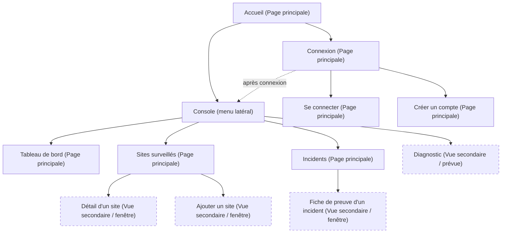

# École Supérieure des Communications de Tunis (Sup'Com)

**Projet Web — Objectif 2**  
**Conception, arborescence et prototypage du site web**

## LinkPulse — Application web de supervision de sites web

* **Membres :** Rana Ben Salem, Mohammed Oussema Chihi
* **Responsable du cours :** Dr. Maroua Nouioua
* **Année universitaire :** 2026/2027

---

## Table des matières

1. **Contexte et objectif de cette étape** (Page 2)
2. **Structure et arborescence du site (sitemap)** (Page 2)
   * 2.1 Organisation générale
   * 2.2 Schéma de l'arborescence
   * 2.3 Règle des trois clics
3. **Prototypage des pages principales** (Page 3)
   * 3.1 Éléments communs
   * 3.2 Page d'accueil
   * 3.3 Page de connexion
   * 3.4 Tableau de bord
   * 3.5 Sites surveillés
   * 3.6 Détail d'un site
   * 3.7 Registre des incidents
4. **Design et identité visuelle** (Page 9)
   * 4.1 Ligne graphique
   * 4.2 Palette de couleurs
   * 4.3 Typographies
   * 4.4 Icônes, boutons et composants
   * 4.5 Accessibilité et responsive
5. **Choix de technologies** (Page 10)
   * 5.1 Pile technologique
   * 5.2 Justification
   * 5.3 Outils de conception
6. **En résumé** (Page 11)
7. **Références** (Page 11)

---

## 1. Contexte et objectif de cette étape

Après avoir défini la vision, le public cible et les objectifs de LinkPulse (Objectif 1), cette étape pose les bases visuelles et techniques du site : l'arborescence, les prototypes, l'identité visuelle et les choix technologiques. Ce document regroupe :
* Le schéma de l'arborescence du site (*sitemap*) ;
* Les prototypes des pages principales ;
* La charte graphique (couleurs, polices, icônes, styles) ;
* La justification du choix technologique.

---

## 2. Structure et arborescence du site (sitemap)

### 2.1 Organisation générale
Le site est organisé en deux espaces :
* **Un espace public :** la page d'accueil et la page de connexion, avec possibilité de créer un compte ;
* **Un espace connecté :** la console, pilotée par un menu latéral permanent qui donne accès au tableau de bord, aux sites surveillés, aux incidents et au diagnostic.

Chaque utilisateur connecté ne voit que ses propres sites.

### 2.2 Schéma de l'arborescence

* **Figure 1 — Arborescence (sitemap) du site LinkPulse :**



*Légende :*
* **Encadré plein :** Page principale
* **Encadré en pointillés :** Vue secondaire, fenêtre ou page prévue

### 2.3 Règle des trois clics
Une fois connecté, l'utilisateur doit trouver une information en **trois clics maximum**. Le menu latéral et les raccourcis du tableau de bord permettent de rester bien en dessous de cette limite.

| Destination | Chemin depuis le tableau de bord | Clics |
| :--- | :--- | :---: |
| **Sites surveillés** | Menu latéral, entrée « Sites surveillés » | 1 |
| **Incidents** | Menu latéral, entrée « Incidents » | 1 |
| **Diagnostic** | Menu latéral ou bouton « Diagnostiquer » de l'alerte | 1 |
| **Détail d'un site** | Sites surveillés, puis clic sur le site | 2 |
| **Ajouter un site** | Sites surveillés, puis bouton « Ajouter un site » | 2 |
| **Fiche de preuve** | Incidents, puis clic sur un incident | 2 |

---

## 3. Prototypage des pages principales

### 3.1 Éléments communs
Toutes les pages reposent sur les mêmes éléments clés :
* **En-tête :** logo, menu, barre de recherche (« Rechercher un service... »), état global du système et accès au profil ;
* **Zones de contenu :** cartes de synthèse, graphiques de latence, tableaux et journaux ;
* **Boutons d'action :** connexion, ajout d'un site, rafraîchissement, diagnostic, export ;
* **Pied de page :** version du produit et liens de navigation (page d'accueil).

Le wireframe de la **Figure 2** valide la structure commune de la console (menu latéral, barre supérieure, cartes de synthèse en haut, zone de contenu) avant le passage aux prototypes détaillés :

```text
+-------------------+-------------------------------------------------------------------+
|       Logo        |          État global       |       Recherche       |      Profil  |
+-------------------+-------------------------------------------------------------------+
|                   | +---------------------------------------------------------------+ |
|  Tableau de bord  | |              Titre de la page  |  Boutons d'action            | |
|                   | +---------------------------------------------------------------+ |
|  Sites surveillés |                                                                   |
|                   | +---------------+ +---------------+ +---------------+ +-----------+ |
|     Incidents     | | Carte synth.  | | Carte synth.  | | Carte synth.  | | Carte     | |
|                   | +---------------+ +---------------+ +---------------+ +-----------+ |
|    Diagnostic     |                                                                   |
|                   | +---------------------------------------------------------------+ |
|                   | |                                                               | |
|                   | |                       Zone de contenu                         | |
|                   | |                (graphique, tableau ou journal)                | |
|                   | |                                                               | |
|   Sonde locale    | +---------------------------------------------------------------+ |
+-------------------+-------------------------------------------------------------------+
```

### 3.2 Page d'accueil
Page vitrine publique qui présente la valeur de l'outil et conduit à la création d'un compte (*Figure 3 — Prototype de la page d'accueil*).
* **En-tête :** logo, menu (*Accueil*, *Fonctionnalités*, *Comment ça marche*, *Connexion*) et boutons « Connexion » et « Commencer » ;
* **Bloc d'accroche :** titre (*« Surveillez vos sites web en toute sérénité, sans jargon ni fausses alertes »*), boutons « Commencer gratuitement » et « Voir la démo », et un aperçu de la console ;
* **Arguments & fonctionnalités :** trois chiffres clés, puis quatre cartes de fonctionnalités (*surveillance continue*, *alertes sans jargon*, *historique et preuves*, *espace sécurisé*) ;
* **Prise en main & pied de page :** trois étapes de mise en place (*« Opérationnel en 10 secondes, montre en main »*), un appel final « Créer mon compte » et un pied de page.

### 3.3 Page de connexion
Une carte centrée regroupe tout le parcours d'accès (*Figure 4 — Prototype de la page de connexion et de création de compte*).
* **Deux onglets :** « Se connecter » et « Créer un compte » ;
* **Deux connexions externes :** GitHub, Google SSO ;
* **Champs :** e-mail et mot de passe (affichage du mot de passe, lien « Oublié ? ») ;
* **Action & confiance :** bouton principal « Se connecter à la console » et indicateurs de confiance (TLS 1.3, RGPD, SOC 2).

### 3.4 Tableau de bord
Page d'arrivée après la connexion : elle indique en un coup d'œil l'état des sites (*Figure 5 — Prototype du tableau de bord*).
* **Alerte active :** bannière d'incident critique avec les boutons « Détails » et « Diagnostiquer » ;
* **Quatre cartes de synthèse :** disponibilité globale, temps de réponse moyen, sites surveillés, incidents ouverts ;
* **Visualisation :** graphique du temps de réponse (périodes `1H`, `24H`, `7J`) avec seuil critique ;
* **Suivi & historique :** liste de l'état des services surveillés et journal des derniers événements avec export CSV.

### 3.5 Sites surveillés
Liste des sites avec leur état, leur temps de réponse et leur disponibilité (*Figure 6 — Prototype de la page « Sites surveillés »*).
* **Actions :** boutons « Ajouter un site » et « Rafraîchir » ;
* **Filtres :** par état (*Tous*, *En ligne*, *Hors ligne*) et par nom ou URL ;
* **Tableau :** site, état, temps de réponse avec mini-courbe, disponibilité sur 30 jours, dernier contrôle, actions ;
* **Mise en évidence :** ligne en alerte mise en évidence en rouge.

### 3.6 Détail d'un site
Courbe du temps de réponse et dernières mesures d'un site (*Figure 7 — Prototype de la page de détail d'un site*).
* **Navigation & action :** fil d'Ariane avec retour vers « Sites surveillés » et bouton « Lancer un test immédiat » ;
* **Cartes :** disponibilité sur 30 jours, temps de réponse moyen, dernier contrôle HTTP et certificat TLS ;
* **Graphique :** profil de latence RTT sur 24 heures avec seuil d'alerte ;
* **Historique :** tableau des dernières vérifications : horodatage, code HTTP, temps de réponse, sonde, résultat.

### 3.7 Registre des incidents
Problèmes détectés, avec début, durée, gravité et preuves (*Figure 8 — Prototype du registre des incidents*).
* **Indicateurs du jour :** incidents, temps moyen de résolution, disponibilité sur 24 heures ;
* **Filtres :** onglets « Tous », « En cours », « Résolus » et champ de filtre ;
* **Liste :** registre chronologique des incidents avec identifiant, code d'erreur et région ;
* **Détail :** fiche de preuve de l'incident sélectionné : type d'erreur, durée, sonde de confirmation, chronologie horodatée ;
* **Graphique :** graphique des erreurs sur 24 heures.

---

## 4. Design et identité visuelle

### 4.1 Ligne graphique
LinkPulse adopte une ligne graphique technique, sombre et sobre, adaptée à un outil de supervision consulté de jour comme de nuit : fond bleu nuit, cartes légèrement plus claires, textes clairs et couleurs d'état très lisibles. Elle répond aux conséquences sur le design définies à l'Objectif 1 : interface sobre, codes couleur d'état, cartes de synthèse en haut du tableau de bord, parcours de connexion simple. L'interface est identique sur toutes les pages pour assurer la cohérence visuelle.

### 4.2 Palette de couleurs

| Couleur | Code | Usage |
| :--- | :--- | :--- |
| **Bleu nuit** | `#051424` | Fond principal des pages |
| **Ardoise** | `#0D1C2D` | Cartes, menu latéral, tableaux |
| **Noir bleuté** | `#010F1F` | Champs de saisie, zones de graphiques |
| **Bleu d'action** | `#0267B8` | Boutons principaux, onglet et entrée de menu actifs |
| **Bleu clair** | `#ADC6FF` | Liens, accents, chiffres mis en avant |
| **Vert opérationnel** | `#4EDEA3` | État « En ligne », succès |
| **Rouge corail** | `#FFB4AB` | État « Hors ligne », erreurs, alertes |
| **Rouge sombre** | `#3E0C19` | Fond des bannières et lignes en incident |
| **Blanc bleuté** | `#D9E9FF` | Texte principal et titres |

Les couleurs d'état sont utilisées de façon constante : **vert** pour un site en ligne, **rouge** pour une panne, **bleu** pour les actions et l'information.

### 4.3 Typographies
* **Titres et chiffres clés :** police sans empattement de style géométrique, en graisse semi-grasse, en grande taille pour les indicateurs (par exemple `99,98%`) ;
* **Textes et boutons :** même famille, en taille moyenne, pour une lecture rapide ;
* **Étiquettes et données techniques** (codes HTTP, URL, identifiants, horodatages) : capitales à espacement élargi ou chasse fixe, pour distinguer la donnée brute du texte.

### 4.4 Icônes, boutons et composants
* **Icônes :** style filaire (contour fin), monochromes, de taille homogène ;
* **Boutons :** coins légèrement arrondis ; bouton principal plein en bleu d'action, boutons secondaires sur fond ardoise ;
* **Cartes :** fond ardoise, coins arrondis, espacement régulier ;
* **Badges d'état :** pastille de couleur et texte (« En ligne », « Critique », « Résolu », « En veille ») ;
* **Graphiques :** courbes lissées avec remplissage dégradé et seuil d'alerte en pointillé.

### 4.5 Accessibilité et responsive
* **Contraste élevé :** texte clair sur fond très sombre ;
* **Lisibilité non exclusivement chromatique :** l'état n'est jamais indiqué par la couleur seule ; chaque badge porte aussi un libellé ;
* **Adaptabilité :** mise en page en grille, adaptée aux écrans d'ordinateur et de téléphone ; le menu latéral et les cartes se réorganisent sur écran étroit.

---

## 5. Choix de technologies

### 5.1 Pile technologique
Les pistes envisagées à l'Objectif 1 sont conservées :

| Couche | Technologie | Rôle dans LinkPulse |
| :--- | :--- | :--- |
| **Interface** | Angular [1] (HTML, CSS, JavaScript) | Pages de la console construites à partir de composants réutilisables. |
| **Serveur** | Python (FastAPI [2]) | Vérification périodique des sites, détection des incidents, API REST. |
| **Base de données** | Microsoft SQL Server [3] | Utilisateurs, sites, mesures horodatées et incidents. |
| **Communication** | API REST | Échanges entre Angular et le serveur ; accès réservé aux utilisateurs connectés. |

### 5.2 Justification
* Les blocs répétés des maquettes (carte de synthèse, badge d'état, tableau, menu latéral) correspondent directement à des composants Angular ;
* Le gabarit commun de la Figure 2 se code une seule fois et se réutilise sur toutes les pages ;
* Les couleurs de la charte deviennent des variables CSS, ce qui garantit la cohérence visuelle ;
* FastAPI et SQL Server couvrent le noyau du projet (mesures, incidents, authentification) sans complexité inutile ;
* Les prototypes peuvent être convertis facilement en code, ce qui prépare la phase de développement.

### 5.3 Outils de conception
Les prototypes (*canvas*) des pages ont été générés avec **Stitch**, l'outil de conception d'interfaces assisté par intelligence artificielle, puis exportés sous forme de captures d'écran présentées dans ce document. Cet outil permet d'obtenir rapidement des maquettes détaillées et cohérentes entre elles, que l'équipe a ensuite relues et validées par rapport au sitemap. Le sitemap et le wireframe sont dessinés directement dans ce document.

---

## 6. En résumé

* **Quelle structure ?** Un espace public (accueil, connexion) et une console à menu latéral de quatre entrées, où toute information est atteinte en trois clics maximum.
* **Quelle apparence ?** Six pages prototypées, une ligne graphique sombre et sobre, avec des couleurs d'état constantes (vert, rouge) et des composants identiques d'une page à l'autre.
* **Quelles technologies ?** Angular pour l'interface, Python (FastAPI) pour le serveur, Microsoft SQL Server pour les données, reliés par une API REST.

---

## Références

1. **Angular** — framework de développement d'interfaces web. <https://angular.dev>. Consulté en 2026.
2. **FastAPI** — framework Python pour la création d'API. <https://fastapi.tiangolo.com>. Consulté en 2026.
3. **Microsoft SQL Server** — système de gestion de bases de données. <https://www.microsoft.com/sql-server>. Consulté en 2026.