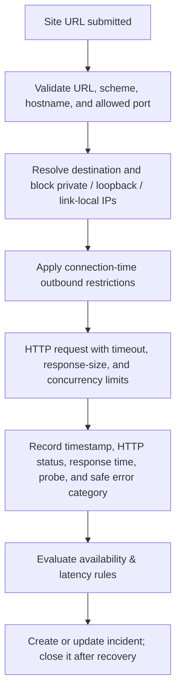

# LINKPULSE — Updated Guided Implementation Handbook

**Frontend, FastAPI Backend, SQL Server, Security**  
*Aligned with the Objectif 2 sitemap, page prototypes, and visual identity*  
*Prepared: 11 November 2026*

---

## How This Updated Guide Should Be Used

This handbook keeps the original technical baseline—**Angular**, **Python FastAPI**, and **Microsoft SQL Server**—but updates the implementation scope so the code matches the *LinkPulse Objectif 2* document. Build and test one milestone at a time.

> **Scope distinction:** The prototype document defines the intended screens and visible information. It does not fully define every business rule, API payload, monitoring threshold, or external integration. Where a technical decision is still open, this guide labels it as a **team decision** instead of presenting it as an established prototype requirement.

### What the Application Contains

| Area | Pages / Sections | Purpose |
| :--- | :--- | :--- |
| **Public space** | Home; Login / Create account | Introduce LinkPulse and allow account access. |
| **Connected console** | Dashboard; Monitored sites; Site details; Incidents; Diagnostic | Display monitoring data and allow monitoring tasks. |
| **Secondary views** | Add site; Incident evidence sheet; Profile | Can be implemented as a modal, drawer, or nested page where appropriate. |

The prototype describes six principal page designs: **Home**, **Login**, **Dashboard**, **Monitored Sites**, **Site Details**, and **Incident Register**. **Diagnostic**, **Add Site**, and **Incident Evidence** are also part of the sitemap as secondary views. Therefore, they should not be forgotten when planning routes and components.

---

## 1. Product Scope and Implementation Order

### 1.1 Main User Journey

* An anonymous visitor lands on **Home** and can navigate to **Login** or **Create account**.
* After successful authentication, the user enters the **connected console**.
* The permanent sidebar provides **Dashboard**, **Monitored Sites**, **Incidents**, and **Diagnostic** navigation.
* The user can add a site, open its detail view, run an immediate test, inspect incidents, and open an incident evidence sheet.
* Every user sees **only their own** monitored sites, measurements, and incidents.

### 1.2 Updated Implementation Milestones

| Milestone | Build | Definition of Done |
| :--- | :--- | :--- |
| **A - Setup** | Angular project, Python environment, FastAPI health | Angular runs; `/health` responds; dependencies install cleanly. |
| **B - Shared UI** | Public layout, console shell, sidebar, top bar, palette | Responsive layouts and styles follow the prototypes. |
| **C - Authentication** | Register, login, logout, current-user profile | Public/private route flow works; backend protects private routes. |
| **D - Database** | Users, sites, probes, checks, incidents, and migrations | SQL Server schema is created and ownership relationships work. |
| **E - Site management** | List, filter, add, edit, pause/resume, delete/archive | Sites page displays real API data and supports site actions. |
| **F - Monitoring** | Scheduled checks, immediate checks, response time, and status | Worker persists check data safely and can be displayed in history. |
| **G - Incidents** | Incident lifecycle, filters, timeline, and evidence detail | Incident register and evidence view show consistent records. |
| **H - Dashboard & diagnostics** | Summary cards, latency chart, global state, diagnostic view, CSV export | Metrics and charts are supplied by API and displayed accurately. |
| **I - Security & release** | SSRF & CSRF defenses, authorization tests, audit, responsive & deployment checks | Security tests pass; secrets are not committed. |

> **Recommended first vertical slice:** Register/login $\rightarrow$ create one monitored site $\rightarrow$ persist it in SQL Server $\rightarrow$ list it in Monitored Sites. Then add the monitoring worker and connect the remaining screens.

---

## 2. Technology and Project Structure

### 2.1 Technology Baseline

| Layer | Technology | Responsibility |
| :--- | :--- | :--- |
| **Frontend** | Angular + TypeScript + HTML + SCSS | Pages, reusable components, forms, charts, and navigation. |
| **Backend** | Python + FastAPI | Authentication, validation, monitoring, incident rules, and REST endpoints. |
| **Database** | Microsoft SQL Server | Users, monitored sites, probes, check history, and incidents. |
| **Data access** | SQLAlchemy ORM | Safe database queries and model relationships. |
| **Migrations** | Alembic | Versioned database schema changes. |
| **Monitoring** | HTTPX + APScheduler | HTTP checks and scheduled execution. |
| **API communication** | REST over HTTPS in production | Angular communicates with FastAPI; the browser never connects directly to SQL Server. |

### 2.2 Recommended Repository Layout

```text
LinkPulse/
├── frontend/
│   └── linkpulse-ui/
│       └── src/
│           └── app/
│               ├── core/
│               │   ├── guards/
│               │   ├── interceptors/
│               │   └── services/
│               ├── layout/
│               │   ├── public-layout/
│               │   ├── console-layout/
│               │   ├── sidebar/
│               │   ├── topbar/
│               │   └── footer/
│               ├── shared/
│               │   ├── status-badge/
│               │   ├── metric-card/
│               │   ├── data-table/
│               │   ├── chart/
│               │   ├── loading-state/
│               │   └── empty-state/
│               ├── pages/
│               │   ├── home/
│               │   ├── auth/
│               │   ├── dashboard/
│               │   ├── monitored-sites/
│               │   ├── site-details/
│               │   ├── incidents/
│               │   └── diagnostic/
│               ├── app.routes.ts
│               └── app.config.ts
├── backend/
│   ├── app/
│   │   ├── api/
│   │   ├── core/
│   │   ├── models/
│   │   ├── schemas/
│   │   ├── services/
│   │   ├── workers/
│   │   └── main.py
│   ├── alembic/
│   ├── tests/
│   ├── requirements.txt
│   ├── .env.example
│   └── .env
├── docs/
├── .gitignore
└── README.md
```

*Note: The Angular CLI may produce slightly different filenames depending on its version. Keep the feature boundaries above, but follow the actual generated filenames.*

---

## 3. Frontend Implementation Aligned with the Prototypes

### 3.1 Public Home Page
* **Header:** LinkPulse logo and navigation links for *Home*, *Features*, *How it works*, and *Login*; include **Login** and **Get started** calls to action.
* **Hero:** Concise value proposition, buttons for starting free and viewing a demo, plus a preview of the console.
* **Key figures & features:** Three key figures, followed by four feature cards (*continuous monitoring*, *understandable alerts*, *history and evidence*, *secure workspace*).
* **Onboarding & footer:** Three-step setup explanation, final account-creation call to action, and footer.
* **Data integrity:** Do not invent performance statistics. Use clearly marked illustrative values only in a mockup/demo, or replace them with verified project metrics.

### 3.2 Login and Create Account
* Use two tabs or modes: **Sign in** and **Create account**.
* Support email and password fields, password visibility control, and a *Forgot password* link or placeholder flow.
* Show GitHub and Google SSO buttons **only** if the team implements and configures those providers. Otherwise mark them as planned/disabled; do not make decorative buttons appear functional.
* Show TLS 1.3, GDPR, and SOC 2 trust labels only if the project can substantiate those claims. For a student prototype, use neutral security messaging instead of implying certification or compliance.
* Use generic authentication failure messages, validation, loading states, and rate limiting.

### 3.3 Connected Console Shared Layout
* **Persistent sidebar:** Dashboard, Monitored Sites, Incidents, and Diagnostic.
* **Top bar:** Logo, global system state, service search, and profile access.
* **Content region:** Page title, action buttons, metric cards, charts, tables, or event journal.
* **Footer:** Product version and Home navigation.
* **Responsiveness:** Use a responsive sidebar that collapses or becomes a mobile navigation panel on narrow screens.

### 3.4 Dashboard
* Critical incident banner with **Details** and **Diagnose** actions.
* Four metric cards: *global availability*, *average response time*, *monitored sites*, and *open incidents*.
* Response-time chart with `1H`, `24H`, and `7D` range controls and a clearly marked critical threshold.
* Monitored-service status list and recent event journal.
* CSV export action for the relevant dashboard/event data.
* Show loading, error, empty, and populated states. Define the exact formula and time window for global availability and average response time.

### 3.5 Monitored Sites
* **Add Site** and **Refresh** actions.
* Status filters: *All*, *Online*, and *Offline*; text search by site name or URL.
* Table columns: *site*, *status*, *response time with mini-chart*, *30-day availability*, *last check*, and *actions*.
* Highlight problematic rows with the prototype's red incident treatment, while retaining a text status label.
* Site actions should include opening details and the agreed edit/pause/resume/delete actions. Confirm destructive deletion.

### 3.6 Site Details
* Breadcrumb back to **Monitored Sites** and a **Run immediate test** action.
* Metric cards: *30-day availability*, *average response time*, *last HTTP check*, and *TLS certificate information*.
* 24-hour latency profile with alert threshold.
* Recent checks table: *timestamp*, *HTTP status code*, *response time*, *probe*, and *result*.
* Show explicit unavailable/unknown values when TLS or probe data has not been collected; do not fabricate it.

### 3.7 Incident Register
* Daily indicators: *incident count*, *average resolution time*, and *24-hour availability*.
* Tabs: *All*, *Ongoing*, and *Resolved*; include a text filter.
* Chronological incident register with identifier, error code, and region.
* Selecting an incident opens its evidence sheet: *error type*, *duration*, *confirming probe*, and *timestamped timeline*.
* Include a 24-hour error chart.

### 3.8 Diagnostic View
The sitemap includes **Diagnostic** as a console destination, and the dashboard's critical alert includes a **Diagnose** action. The prototype text does not specify the exact diagnostic algorithm or detailed screen layout. Implement a first version as a diagnostic result view that explains the observed failure using stored check evidence: DNS/connection outcome, HTTP status if available, response time, TLS metadata if collected, probe, and timestamp. Do not claim root-cause certainty when the checks only show symptoms.

### 3.9 Add Site and Incident Evidence
The sitemap presents **Add Site** and the **incident evidence sheet** as secondary views. A modal/drawer is suitable for Add Site; the evidence sheet can be a detail route or side panel. Both must be directly reachable from the relevant parent page.

---

## 4. Visual Identity and Reusable Design System

| Token | Value | Usage |
| :--- | :--- | :--- |
| **Main background** | `#051424` | Main page background. |
| **Surface / slate** | `#0D1C2D` | Cards, sidebar, and tables. |
| **Input / chart dark** | `#010F1F` | Input fields and chart areas. |
| **Action blue** | `#0267B8` | Primary buttons, active tab, and active navigation. |
| **Light blue** | `#ADC6FF` | Links, accents, and highlighted figures. |
| **Online green** | `#4EDEA3` | Online and success states. |
| **Offline coral** | `#FFB4AB` | Offline, error, and alert states. |
| **Incident dark red** | `#3E0C19` | Critical banners and incident rows. |
| **Main text** | `#D9E9FF` | Body text and headings. |

* **Typography:** Use a geometric sans-serif style for headings and key metrics; use the same family for body text and buttons. Use monospaced or letter-spaced styling for HTTP codes, URLs, identifiers, and timestamps.
* **UI Components:** Use thin outline icons, slightly rounded buttons and cards, regular spacing, and consistent status badges.
* **Charts:** Use smooth lines, subtle gradient fill, and a dotted alert threshold.
* **Accessibility & Responsiveness:** Never communicate state by color alone; include labels such as *Online*, *Critical*, *Resolved*, and *Paused*. Check contrast and keyboard navigation. Make tables usable on mobile through horizontal scrolling or a card layout.

---

## 5. Backend Data Model

The original guide defines `Users`, `MonitoredSites`, `CheckResults`, and `Incidents`. The prototypes expose additional information (probe, TLS certificate, region, incident evidence, and diagnostic results). The following is a practical extension of that foundation; confirm final fields with the team before migrations.

| Entity | Suggested Fields / Purpose |
| :--- | :--- |
| **User** | `id`, `email` (unique/normalized), `password_hash`, `created_at`, `is_active` |
| **MonitoredSite** | `id`, `user_id` (FK), `name`, `url`, `is_enabled`, `check_interval_seconds`, `created_at`, `updated_at` |
| **Probe** | `id`, `name`, `region`, `location`/`description`, `is_active`. Represents the probe used for a check. |
| **CheckResult** | `id`, `site_id` (FK), `probe_id` (FK nullable), `checked_at` (UTC), `success`, `http_status`, `response_time_ms`, `error_code`/`category`, `tls_metadata` (nullable) |
| **Incident** | `id`, `site_id` (FK), `incident_type`, `severity`, `status`, `error_code`, `region`, `started_at`, `last_seen_at`, `ended_at`, `summary` |
| **IncidentEvidence** | `id`, `incident_id` (FK), `probe_id` (FK nullable), `event_time` (UTC), `evidence_type`, `safe_summary`, `related_check_id` (nullable) |
| **Optional DiagnosticRun** | `id`, `site_id` (FK), `requested_by_user_id` (FK), `started_at`, `completed_at`, `status`, `result_summary`; add only if diagnostic runs need persistence. |

* **Relationships & Ownership:** One user owns many monitored sites. Each site has many check results and incidents.
* **Probes:** A check may be associated with a probe; if the project initially uses only one local probe, retain the model but allow a single configured probe.
* **Evidence Privacy:** An incident has multiple evidence events. Do not store full response bodies, cookies, or sensitive headers as evidence.
* **Database Standards:** Use UTC timestamps and indexes on foreign keys, site/time, incident status, and start time.
* **TLS Inspection:** Store only the TLS metadata required by the prototype; certificate inspection must be implemented and tested separately from ordinary HTTP status checks.

> **Metrics needing a team definition:** Global availability formula, 30-day availability formula, average response-time window, severity levels, incident grouping/deduplication, region source, and how many probes are required for confirmation.

---

## 6. REST API Design

Suggested endpoint contract matching the pages. Keep request/response schemas typed and document them in FastAPI OpenAPI.

| Method + Path | Purpose |
| :--- | :--- |
| `POST /api/auth/register` | Create account; hash password. |
| `POST /api/auth/login` | Authenticate and establish session. |
| `POST /api/auth/logout` | End session. |
| `GET /api/auth/me` | Return safe current-user profile. |
| `GET /api/dashboard/summary` | Global availability, average response time, site count, and open incidents. |
| `GET /api/dashboard/latency?range=1h\|24h\|7d` | Dashboard latency series and threshold. |
| `GET /api/dashboard/events` | Recent events for dashboard journal. |
| `GET /api/dashboard/export.csv` | Export authorized dashboard/event data as CSV. |
| `GET /api/sites` | List current user's sites; support status/search filters and pagination. |
| `POST /api/sites` | Add a monitored site. |
| `GET /api/sites/{site_id}` | Site details and current metrics. |
| `PATCH /api/sites/{site_id}` | Edit name, interval, or enabled state. |
| `DELETE /api/sites/{site_id}` | Delete/archive an owned site according to retention policy. |
| `POST /api/sites/{site_id}/checks/run` | Request an immediate check. |
| `GET /api/sites/{site_id}/checks` | Recent checks and history. |
| `GET /api/sites/{site_id}/latency?range=24h` | Latency chart data. |
| `GET /api/incidents` | List incidents; support all/ongoing/resolved and text filters. |
| `GET /api/incidents/{incident_id}` | Incident evidence sheet and timeline. |
| `GET /api/diagnostics/sites/{site_id}/latest` | Latest diagnostic summary for an owned site. |
| `POST /api/diagnostics/sites/{site_id}/run` | Run a diagnostic check, if synchronous/asynchronous behavior is agreed. |

*The endpoints above are a proposed contract derived from the prototype functions, not endpoints explicitly specified in the design document. Agree on JSON field names and response examples before implementing Angular services.*

### 6.1 Frontend Service Mapping

| Angular Service | Responsibilities |
| :--- | :--- |
| `AuthService` | Register, login, logout, current user. |
| `DashboardService` | Summary cards, latency chart, recent events, CSV export. |
| `SitesService` | List/filter, create, update, pause/resume, delete, details. |
| `ChecksService` | Immediate test and check history. |
| `IncidentsService` | Incident list, filters, evidence details, and timeline. |
| `DiagnosticsService` | Run/read diagnostic results. |
| `ProfileService` | Read/update safe profile information if profile editing is included. |

---

## 7. Monitoring, Metrics, and Incident Lifecycle

### 7.1 Monitoring Flow



* Use **HTTPX** for outbound requests and **APScheduler** for periodic checks.
* An immediate test should use the same validation and SSRF protections as scheduled checks.
* Initially, open one availability incident after **three consecutive failed checks**; close it when checks succeed again (this is the original guide's initial rule).
* Do not create duplicate active incidents for the same site and condition; update `last_seen_at` and evidence instead.
* Slow-response threshold and evaluation window remain a **team decision**. The original guide offers `2,000 ms` over the last three successful checks only as a possible starting proposal.
* Calculate availability from stored check outcomes over a clearly defined time window. Exclude paused periods or explain how they are counted.
* Do not run multiple scheduler instances that duplicate checks. For the first student version, use **one worker process**.

### 7.2 Security Requirements for URL Monitoring
* Allow only `HTTP` and `HTTPS`; reject embedded URL credentials.
* Reject loopback, private, link-local, multicast, reserved, and other non-public destination addresses.
* Protect against DNS rebinding by enforcing restrictions at connection time or through controlled egress.
* Disable redirects initially or validate every redirect target with the same rules.
* Restrict ports (normally `80` and `443`), request timeouts, response bytes, and concurrency.
* Never allow checks to reach `localhost`, SQL Server, internal administration endpoints, or cloud metadata services.

---

## 8. Authentication, Authorization, and Security

* Hash passwords with **Argon2** using `pwdlib[argon2]`. Never store plaintext passwords.
* Prefer an `HttpOnly`, `Secure`-in-production cookie for browser sessions; implement CSRF token validation and `Origin` checks for state-changing requests.
* Use short-lived access sessions, generic login errors, and rate limiting.
* Every private endpoint must authenticate the user and filter records by that user's ID. **Never trust `user_id` from the browser.**
* Use SQLAlchemy ORM / bound parameters; never concatenate user input into SQL.
* Use Angular interpolation and built-in sanitization; do not inject untrusted strings as raw HTML.
* Allow only the configured frontend origin in CORS; wildcard origins must not be used with credentials.
* Keep secrets in `backend/.env` / environment variables; commit only `.env.example`.
* Use HTTPS in production, safe security headers, and non-detailed client errors.
* GitHub/Google sign-in requires real OAuth/OIDC configuration and callback handling; it is not enabled merely by adding a button.

### 8.1 Trust and Compliance Labels
The prototype shows **TLS 1.3**, **GDPR**, and **SOC 2** indicators. TLS 1.3 is a transport configuration claim; GDPR and SOC 2 imply legal/compliance or assurance claims. Do not present the application as GDPR-compliant or SOC 2-certified unless the team has evidence and the claim is accurate. For the student demo, replace unsupported certification badges with factual statements such as *"HTTPS enabled in deployment"* only after verification.

---

## 9. Installation and Run Commands

### 9.1 Frontend
```bash
cd LinkPulse/frontend
npm install -g @angular/cli
ng new linkpulse-ui --routing --style=scss
cd linkpulse-ui
ng serve
# Open http://localhost:4200
```
Generate page components for `home`, `auth`, `dashboard`, `monitored-sites`, `site-details`, `incidents`, and `diagnostic`.  
Generate shared `console-layout`, `sidebar`, `topbar`, `footer`, `status-badge`, `metric-card`, `chart`, and `data-table` components.

### 9.2 Backend (PowerShell)
```powershell
cd LinkPulse/backend
python -m venv venv
.\venv\Scripts\Activate.ps1
python -m pip install --upgrade pip
python -m pip install -r requirements.txt
python -m pip check
pip-audit
```
*Note: Install **Microsoft ODBC Driver 18 for SQL Server** separately. Installing the Python package `pyodbc` does not install the operating-system ODBC driver.*

### 9.3 Run FastAPI
```bash
# From backend/ with the virtual environment active
uvicorn app.main:app --reload

# Verify:
# http://127.0.0.1:8000/health
# http://127.0.0.1:8000/docs
```

### 9.4 Environment Variables
```env
APP_ENV=development
DATABASE_URL=your_local_sql_server_connection
JWT_SECRET_KEY=generate_a_random_secret
ACCESS_TOKEN_EXPIRE_MINUTES=15
FRONTEND_ORIGIN=http://localhost:4200
```
Generate a local secret with:
```bash
python -c "import secrets; print(secrets.token_urlsafe(48))"
```
Never commit `backend/.env` or place secrets in Angular environment files.

---

## 10. Requirements File

Save the separate `requirements.txt` supplied with this guide in the `backend/` directory. It preserves the packages in the original handbook: FastAPI, Uvicorn, SQLAlchemy, pyodbc, Alembic, Pydantic Settings, dotenv, email validation, Argon2 password hashing, JWT, HTTPX, APScheduler, SlowAPI, pytest, coverage, and pip-audit.

```text
# LinkPulse backend dependencies
# Python 3.11+

# FastAPI application and ASGI server
fastapi>=0.115,<1.0
uvicorn[standard]>=0.30,<1.0

# SQL Server database access and schema migrations
sqlalchemy>=2.0,<3.0
pyodbc>=5.0,<6.0
alembic>=1.13,<2.0

# Settings, environment variables, and request validation
pydantic-settings>=2.0,<3.0
python-dotenv>=1.0,<2.0
email-validator>=2.0,<3.0

# Password hashing and JWT/session support
pwdlib[argon2]>=0.2,<1.0
PyJWT>=2.0,<3.0

# Website monitoring and periodic scheduling
httpx>=0.27,<1.0
APScheduler>=3.10,<4.0

# Rate limiting for authentication and sensitive endpoints
slowapi>=0.1,<1.0

# Testing and dependency security auditing
pytest>=8.0,<10.0
pytest-cov>=5.0,<7.0
pip-audit>=2.7,<3.0
```

*No extra Python package is required just to render CSV files; Python's standard `csv` module is sufficient. Angular charting packages are installed separately with `npm` and therefore do not belong in this Python requirements file.*

---

## 11. Testing and Acceptance Criteria

| Feature | Acceptance Check |
| :--- | :--- |
| **Home** | Navigation and calls to action lead to correct public routes. |
| **Register / login** | Valid registration and login work; invalid login returns generic error; rate limiting applies. |
| **Private console** | Unauthenticated user cannot access protected API data. |
| **Ownership** | User A cannot read, update, or delete User B's sites, checks, or incidents. |
| **Dashboard** | All four cards and chart values come from API data and use documented formulas/windows. |
| **CSV export** | Only authorized user's data is exported; output is valid CSV. |
| **Sites** | Search/status filters work; add/edit/pause/resume/delete actions persist. |
| **Immediate check** | Uses the same SSRF-safe path as scheduled checks; result appears in history. |
| **Site detail** | HTTP history, latency, probe, and TLS fields show real values or explicit unavailable states. |
| **Incidents** | All/Ongoing/Resolved filters work; evidence timeline is chronological; duplicate active incidents are avoided. |
| **Diagnostic** | Result is traceable to checks and does not claim unsupported root cause. |
| **Security** | Private IP / localhost URLs rejected; HTML input renders as text; secrets and stack traces are not exposed. |

---

## 12. Git Workflow and Suggested Team Split

* Commit small tested increments, for example `feat: build public home page` or `feat: add site CRUD endpoints`. Never commit `venv/`, `node_modules/`, `.env`, secrets, local database files, or generated credentials.
* **Frontend work:** Public Home, console shell, page components, responsive styles, charts, Angular services, and route guards.
* **Backend work:** Database schema, authentication, site CRUD, monitoring worker, incident lifecycle, diagnostic endpoints, and security tests.
* **Both members:** Agree on API request/response examples, test integrated vertical slices, and review ownership checks.

> **Suggested first task:** Create the Angular application and backend environment, then implement the shared public/console layout with static prototype-aligned content. In parallel, create the FastAPI `/health` route. Do not begin with the monitoring scheduler; first make the application skeleton run reliably.

---

## Appendix: Decisions to Confirm Before Implementation

* Will GitHub and Google sign-in be implemented, or shown as future integrations?
* Will Diagnostic be a separate route, a panel, or a modal? What exact tests will it run?
* What does "region" mean in the incident register, and how will it be determined?
* Will the project use one local probe or multiple probes? What does probe confirmation mean?
* What formulas and windows define global availability, 30-day availability, average response time, and mean time to resolve?
* What latency threshold and evaluation window create a slow-response incident?
* Will site removal be permanent deletion or archival to preserve historical checks and incidents?
* Which incident severity levels and error-code categories will be supported?

---

*Source alignment: This handbook adapts the implementation structure and security foundation from the LinkPulse Guided Frontend + Backend + Security Guide, and uses the sitemap, page descriptions, design palette, and technology choices from `Groupe3_LinkPulse_INDP2A_Projet_Web_Objectif2`. Technical additions are explicitly described as recommendations or decisions to confirm.*